# Purchase Order AI Extractor

An end-to-end automation built in **SAP Build Process Automation** that reads purchase order PDFs from a local folder, extracts the key fields with **SAP Document Information Extraction (DOX)**, and routes the result to a human reviewer for approval, with an email notification on approval.

## What it does

1. A user submits the **PO Intake Form** with the folder path of the incoming PO.
2. A **Desktop Agent** on a local Windows machine runs the `Extract_Local_PO_Data` automation.
3. The automation reads each PDF from `C:/PO_Incoming` and sends it to **DOX** (pre-trained Purchase Order model).
4. A custom script parses the DOX response into PO number, vendor, total amount, document date, and a one-line summary.
5. The processed file is moved to an `Archive` subfolder.
6. A **Review Extracted PO** task appears in **My Inbox** with all extracted values.
7. On approval, an **email** is sent.

## Architecture

```mermaid
flowchart LR
    A[PO Intake Form] --> B[Process]
    B --> C[Desktop Agent<br/>Extract_Local_PO_Data]
    C --> D[Get File Collection]
    D --> E[For Each PDF]
    E --> F[SAP DOX<br/>Extract Data]
    F --> G[Custom script<br/>parse fields]
    G --> H[Set Variable Value]
    H --> I[Move file to Archive]
    I --> J[Review Extracted PO<br/>My Inbox task]
    J -->|Approve| K[Send email]
```

## Tech stack

- SAP Build Process Automation (process, form, approval task, automation)
- SAP Document Information Extraction (DOX), pre-trained Purchase Order model
- SAP Desktop Agent 3 (unattended mode) on Windows
- SAP BTP trial subaccount (us10)
- JavaScript custom scripts inside the automation

## Screenshots

**Review task in My Inbox**

**Process design**

**Automation flow**

## Key implementation notes

- **DOX output shape:** `headerFields` is an object keyed by field name, and each entry holds `value`, `confidence` and `page`. The parsing script reads `headerFields[key].value`.
- **Vendor lookup:** the script tries several candidate keys (for example `senderName`) because DOX only returns a value when it can actually extract one. If none is found, the vendor falls back to a placeholder so reviewers can tell "not extracted" from "pipeline broke".
- **Variable consolidation:** values are initialized once before the loop, then copied into automation-level variables using `Set Variable Value` steps, and the End node returns those variables to the process.

## Setup

1. Use a BTP subaccount on a region where DOX is available (this project uses us10).
2. Subscribe to SAP Build Process Automation and SAP Document Information Extraction, and create the DOX service instance and key.
3. Install the Desktop Agent on a Windows machine, register it with your tenant, and set it to **Unattended** mode.
4. Create `C:/PO_Incoming` and make sure an `Archive` subfolder is available.
5. Import or recreate the project, release it, and deploy it.
6. Put a PO PDF in `C:/PO_Incoming`, start the process from the PO Intake Form, and review the task in My Inbox.

## Known limitations

- **Start forms cannot upload files**, so the form takes a path string and the file must already exist on the agent machine.
- The Desktop Agent must be in **Unattended** mode for real runs. Running the Cloud Studio Tester switches it to Design mode, so switch it back before testing end to end.
- Each run moves the file to `Archive`, so a fresh PDF is needed for every test. An empty folder means zero loop iterations and empty output with no error.
- Extraction quality depends on the PDF layout. Fields DOX cannot extract come back empty.
- Built and tested on a BTP trial account with synthetic purchase orders.

## What I learned

- Every Custom Script output parameter creates its own same-named variable, which led to duplicate variables at different scopes and silently blank fields in real runs. Consolidating variables fixed it.
- The Tester can pass while real runs fail. The process step context in Monitor shows exactly where data goes missing.
- Region matters: DOX was not available in the Singapore region, so I migrated to us10.

## Possible next steps

- Highlight low-confidence fields in the review task.
- Handle multiple files per run with a per-file review task.
- Replace the path input with a document store or email trigger.
- Post approved data to S/4HANA.

## Disclaimer

All sample documents are synthetic. No real vendor, bank, or tax data is included.
